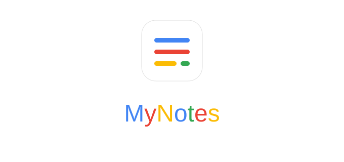

<p align="center">
  
</p>

<h1 align="center">myNotes</h1>

<p align="center">
  <b>A privacy-first, local-first personal knowledge base, calculation notebook, and personal finance OS.</b>
  <br />
  <i>Built with Svelte 5, TypeScript, Vite, TipTap, Numbat WASM, Capacitor, and Electron.</i>
</p>

<p align="center">
  <a href="LICENSE"></a>
  
  
  
  
  
</p>

---

> [!NOTE]
> **🌐 Live Website**: **https://piyushingle007.github.io/myNotes**  
>
> **myNotes** was originally designed and built as a personal daily-driver productivity workspace, and is now completely open source for the community! *(so please don't mind the URL!)*

---

## 📖 Table of Contents

- [💡 Why I Made This](#-why-i-made-this)
- [✨ Overview & Core Principles](#-overview--core-principles)
- [🌟 Complete Feature Atlas](#-complete-feature-atlas)
  - [📝 Rich WYSIWYG & Markdown Editor](#1--rich-wysiwyg--markdown-editor)
  - [🔢 Numbat Calculation Engine & Unit Math](#2--numbat-calculation-engine--unit-math)
  - [🧮 Calculation Box (Calbox) — Smart Budgeting & Dynamic Metrics](#3--calculation-box-calbox--smart-budgeting--dynamic-metrics)
  - [🎨 Visual Diagrams, Whiteboards & Mind Maps](#4--visual-diagrams-whiteboards--mind-maps)
  - [💳 Personal Finance & SMS Expense Tracker](#5--personal-finance--sms-expense-tracker)
  - [🎯 Swipe Planner & Daily Focus Cards](#6--swipe-planner--daily-focus-cards)
  - [☁️ Local-First Storage & Cloud Synchronization](#7--local-first-storage--cloud-synchronization)
  - [🎭 30+ Curated Themes & Modern UI](#8--30-curated-themes--modern-ui)
- [📱 Supported Platforms](#-supported-platforms)
- [🌐 1. Website (Web / PWA) Setup & Running](#-1-website-web--pwa-setup--running)
- [📱 2. Android Mobile App Setup & Build](#-2-android-mobile-app-setup--build)
- [🖥️ 3. macOS Desktop App Setup & Build](#-3-macos-desktop-app-setup--build)
- [🔑 Google Drive Cloud Sync Setup](#-google-drive-cloud-sync-setup)
- [🛠️ Tech Stack & Key Libraries](#-tech-stack--key-libraries)
- [🗺️ Roadmap](#️-roadmap)
- [🤝 Contributing](#-contributing)
- [📄 License](#-license)

---

## 💡 Why I Made This

Let's talk about the state of modern note-taking apps:

1. **Expensive Subscriptions or Restricted Free Tiers**: Almost every decent note app today either demands a \$10–\$15/month subscription just to type text, or restricts their "free" tier by crippling cross-device synchronization behind a strict paywall.
2. **Missing Real Cross-Platform Sync for Free**: The apps that claim to be free often lack cross-platform parity between Web, Android, and macOS, or require configuring brittle, high-maintenance self-hosted servers.
3. **Why Google Drive? You Own Your Data**:
   To solve this once and for all, **myNotes** synchronizes directly with your own Google Drive using OAuth 2.0 PKCE. Why Google Drive? Because you have all the data directly in your own hands (*well, technically it's in Google's hands, but 😂*). There are **no middleman startup servers**, no private database lock-in, and zero risk of an app company shutting down its servers and taking your data with it.
4. **Zero Lock-In Formats**: Your notes are stored as standard HTML, Markdown, and JSON files on your hard drive and in your Google Drive. If you ever walk away from myNotes, your files remain completely readable with any standard browser or text editor.
5. **No Paywalled Features**: Advanced power tools like live spreadsheets, physical unit calculations (Numbat WASM), Draw.io vector graphics, and Mermaid diagrams are 100% free, unrestricted, and open source.

---

## ✨ Overview & Core Principles

**myNotes** is designed for thinkers, builders, researchers, and creators who need more than just a plain text notepad. It merges rich document editing, interactive physical mathematics, dynamic budgeting, visual diagramming, and task management into a single, cohesive workspace.

### 🛡️ Core Pillars

1. **Local-First & Offline By Default**:
   Your notes live directly on your local device—either via the native **HTML5 File System Access API** (direct folder access) or an in-browser **IndexedDB Sandbox**. If your internet connection drops, you have 100% functionality without interruption.
2. **Absolute Privacy & Zero Telemetry**:
   No tracking scripts, no third-party telemetry, no middlemen servers. When cloud sync is enabled, the app communicates directly with your own Google Drive using client-side OAuth 2.0 PKCE.
3. **Zero Vendor Lock-In**:
   Your data is stored in standard HTML, Markdown, and JSON. Attachments remain standard files. You can open, inspect, or backup your notes folder with any standard file explorer or text editor.
4. **Cross-Platform Parity**:
   The exact same reactive Svelte 5 frontend runs seamlessly across modern web browsers (PWA), Android devices (via Capacitor), and macOS desktops (via Electron).

---

## 🌟 Complete Feature Atlas

### 1. 📝 Rich WYSIWYG & Markdown Editor

Powered by a heavily customized [TipTap](https://tiptap.dev/) and ProseMirror core, bridging frictionless markdown typing with rich WYSIWYG formatting:

- **Typography & Formatting**: Bold, italic, underline, strikethrough, highlights with custom colors, subscript, superscript, inline code, and text alignments (left, center, right, justify).
- **Font & Style Controls**: Interactive font family pickers (Sans, Serif, Monospace, Dyslexic-friendly), dynamic font sizing, and foreground/background color pickers.
- **Tables with Cell Controls**: Resizable grid tables with row and column insertion/deletion, custom cell background colors, header rows, and cell border adjustments.
- **Collapsible Details Blocks**: Accordion `<details>` blocks with summary titles and nested content, perfect for structuring long-form notes and reference material.
- **Callout Alert Boxes**: Notice containers with thematic icons and border accents for Info, Warning, Success, and Critical notes.
- **Page Breaks**: Visual print page break markers for generating clean multi-page PDF documents.
- **Rich Media & Attachments**: Upload and embed images, audio, video, PDFs, and spreadsheet files inline, with integrated download and viewing capabilities.
- **LaTeX Math Equations**: Render inline math expressions (`$E=mc^2$`) and centered block math (`\[ \int_0^\infty e^{-x^2} dx \]`) powered by **KaTeX**.

---

### 2. 🔢 Numbat Calculation Engine & Unit Math

Integrated with the [Numbat](https://numbat.dev/) physical dimension and unit calculation engine compiled directly into WebAssembly:

- **Dedicated `.num` Worksheets**: Create standalone calculation scratchpads with live syntax highlighting and reactive evaluations.
- **Unit & Dimension Conversions**: Perform real-world conversions effortlessly:
  - `10 EUR -> INR`
  - `60 mph in km/h`
  - `500 W * 3 hours in kWh`
  - `pressure = 100 kPa; area = 2 m^2; force = pressure * area`
- **Embedded Numbat Blocks**: Embed live `.num` calculation blocks directly inside standard rich-text notes.
- **Zero Latency**: Calculations execute locally in client-side WebAssembly without making any network requests.

---

### 3. 🧮 Calculation Box (Calbox) — Smart Budgeting & Dynamic Metrics

The **Calculation Box** (`calbox`) turns any note into a lightweight personal budgeting and financial ledger surface. It combines natural-language expense tracking, interactive checklists, dynamic savings targets, and structured category attribution:

- **Slash Command & Fast Insertion**: Type `.calc`, `.metric`, `.metrics`, or use `/calc` anywhere inside a note to embed an interactive calculation widget.
- **Natural Language & Inline Value Parsing**: Write expenses or numerical records naturally (e.g. `Swiggy dinner 450`, `Client Invoice +3500`, `Rent -1200`). Amounts, signs (`+` / `-`), and decimal currencies are automatically parsed in real time directly from the text—no rigid, tedious multi-column spreadsheet setup required.
- **Declared Income & Dynamic Savings Hero**:
  - Explicitly declare your Income (e.g., monthly paycheck, budget allowance).
  - The **Savings Hero** card instantly computes `Savings = Income − Total Expenses` (or `Income + Net Balance`).
  - Displays color-coded feedback (emerald green for surplus, crimson red for deficit) so you always know your remaining budget.
- **Calculation Tag Catalog (Multi-Tag Rows)**:
  - Backed by an independent `CalcTagSchema` database in IndexedDB, completely isolated from note organizational tags.
  - Multi-tag attribution: assign one or more categories to a single expense row (e.g. `Groceries` + `Credit Card`).
  - Color-coded tag chips and badges.
  - Per-tag totals with separate `+` (inflows) and `-` (outflows) breakdowns.
  - Quick tag filtering to isolate and focus on specific spending categories.
- **Interactive Checkbox Exclusions (`excludeChecked`)**:
  - Check off rows as settled, paid, or bought.
  - With `excludeChecked` enabled, checked items are dynamically omitted from totals and statistics, making it ideal for pending vs. cleared transactions or shopping lists.
- **Comprehensive Real-Time Statistics**:
  - Live statistical indicators: **Count, Net Total / Sum, Average, Minimum, Maximum, Median, Inflows / Income, Outflows / Expenses**.
  - Customizable visibility toggles to show only the metrics relevant to your workflow.
- **Fluid Keyboard Navigation & Reordering**:
  - Drag-and-drop row reordering with monospaced handles (`⋮⋮`).
  - Press `Enter` on any row to instantly create the next entry.
  - Press `Backspace` on an empty row to delete it.
- **Formatted Excel (`.xlsx`) & CSV Export**:
  - Export the calculation box into a styled Microsoft Excel workbook with colored headers, proper currency formatting, and auto-sized columns via SheetJS (`xlsx`) and `xlsx-js-style`.
  - Export to raw `.csv` for accounting and spreadsheet tools.
- **Vault-Wide Aggregation (Budget Dashboard)**:
  - All calculation boxes across notes automatically feed into the top-level **Budget View** (`#/budget`), giving you a macro financial overview across your entire vault.

---

### 4. 🎨 Visual Diagrams, Whiteboards & Mind Maps

Transform thoughts into visuals directly inside your notes, with built-in bidirectional editing, vector precision, and zero external dependency:

#### 📐 Mermaid.js Dynamic Text-to-Diagrams
- **Declarative Diagram Generation**: Write standard text definitions inside markdown code blocks or the visual Mermaid editor to generate crisp diagrams on the fly.
- **Supported Diagram Types**:
  - **Flowcharts**: Top-down (`graph TD`), Left-to-right (`graph LR`), subgraphs, custom link styles, and conditional branches.
  - **Sequence Diagrams**: Actor lifelines, synchronous/asynchronous arrows, loops, and activation boxes.
  - **Class & State Diagrams**: Class relationships, method definitions, inheritance, state machines (`stateDiagram-v2`), and composite states.
  - **Entity-Relationship (ER) Diagrams**: Database schemas, primary keys, cardinalities, and foreign keys.
  - **Project Management**: Interactive Gantt charts, Timeline roadmaps, and User Journey maps.
  - **Software Architecture**: Git Graph branching history, C4 architecture blocks, Pie charts, and Quadrant graphs.
- **Interactive Visual Editor Modal (`MermaidEditor.svelte`)**:
  - **Multi-View Modes**: Toggle between **Split View** (side-by-side live editor + rendering), **Code-Only View**, or **Full-Screen Preview**.
  - **Touch & Gesture Controls**: Pan, zoom in/out, and pinch-to-zoom on touch screens with reset-view controls.
  - **Live Syntax Validation**: Instant error alerts and line indicators prevent broken documents.
- **Lossless In-Note Embedding**: Rendered as native SVG vectors into note HTML. Double-click any embedded Mermaid diagram to re-open the editor with the source text instantly preserved.
- **One-Click SVG Export**: Download individual diagram SVG graphics directly for presentations or external documentation.

#### 🖌️ Draw.io Vector Drawing & Diagramming Canvas
- **Full Vector Graphics Editor (`DrawIOEditor.svelte`)**: Double-click embedded graphics to launch a vector drawing workspace directly inside the app.
- **Extensive Primitive & Connector Shapes**:
  - Rectangles, rounded boxes, ellipses, circles, diamonds / decision rhombuses, and freeform text blocks.
  - Directed arrows, orthogonal lines, and dynamic connectors that bind to shapes.
- **Lossless Two-Way XML Synchronization**:
  - Diagrams are structured in standard `mxGraphModel` XML, guaranteeing complete compatibility with diagrams.net / Draw.io desktop applications.
  - Seamlessly convert between native shapes, Draw.io XML models, and Mermaid text representations.
- **Embedded Vector Output**: Diagrams are saved as clean SVG vectors inline within your note's HTML file. All shape geometries, coordinates, and styling remain fully editable upon re-opening.

#### 🧠 Markmap Interactive Mind Maps
- **Instant Outline-to-Mindmap**: Transforms nested bullet lists into interactive, expanding, colorful mind maps.
- **Fluid Navigation**: Pan, zoom, collapse, and expand branches dynamically to explore complex hierarchies and brainstorm.

#### ✍️ Stylus & Freehand Canvas (Samsung Notes Mode)
- **Pressure-Sensitive Digital Inking**: Integrated with `perfect-freehand` for smooth stroke rendering, dynamic line weight, and tactile stylus response.
- **Multi-Page Notebooks (`.notebook.json`)**: Organize handwriting into paginated digital notebooks with grid backgrounds and ruled lines.

---

### 5. 💳 Personal Finance & SMS Expense Tracker

Track personal finances and reconcile accounts effortlessly in the **Budget View** (`#/budget`):

- **Automated Android SMS Parsing**: Reads and parses incoming transactional bank SMS alerts on Android devices completely on-device via a native Capacitor plugin. Extracts transaction type (debit/credit), amount, merchant, and timestamp without transmitting financial data to external servers.
- **Visual Income vs. Expense Charts**: View spending trends, monthly burn rates, and tag breakdowns.
- **Category Tag Management**: Color-code expense categories with automatic tag pruning and search filters.
- **Multi-Currency Support**: Configure custom default currency symbols (`$`, `€`, `₹`, `£`, `¥`).

---

### 6. 🎯 Swipe Planner & Daily Focus Cards

A tactile approach to daily productivity in the **Focus View** (`#/focus`):

- **Tinder-Style Swipe Interface**: Cycle through priority task cards using swipe gestures (swipe right to schedule/complete, swipe left to defer).
- **Persistent Card Store**: Backed by `FocusCardStore` in local storage for managing daily backlogs and focus items.

---

### 7. ☁️ Local-First Storage & Cloud Synchronization

- **Storage Adapters**:
  - **Native File System Access**: Read and write files directly from your computer's disk.
  - **IndexedDB Sandbox**: Encrypted local browser database storage for quick access without folder permissions.
- **Google Drive Sync (PKCE + Refresh Token)**:
  - Sign in once with Google using OAuth 2.0 PKCE.
  - Long-lived refresh tokens ensure you remain permanently authenticated across sessions.
  - Background auto-sync pushes changes on a debounced timer whenever you finish typing.
- **Conflict Resolution**: Integrated three-way merge dialog showing local vs. remote diffs with timestamp clock-skew protection.

---

### 8. 🎭 30+ Curated Themes & Modern UI

- **Glassmorphic Aesthetic**: Translucent sidebars, frosted glass panels, subtle border glows, and refined design.
- **3-Panel Resizable Desktop Layout**: Draggable dividers between the Sidebar (navigation), Note List (filter/search), and Editor (writing area).
- **30+ Curated Color Themes**: Includes *Steel Minimalist*, *Dracula*, *Cyberpunk*, *Nord*, *Emerald*, *Solarized*, *Monokai*, and high-contrast modes.
- **Command Palette (`Ctrl+K` / `Cmd+K`)**: Fast fuzzy search across notes, notebooks, commands, and settings powered by MiniSearch.
- **Mobile First Navigation**: Adaptive bottom navigation bar, touch-friendly swipe drawers, and Android hardware back-button integration.

---

## 📱 Supported Platforms

| Platform | Technology | Status | Key Features |
| :--- | :--- | :--- | :--- |
| **Web Browser (PWA)** | Svelte 5 + Vite | ✅ Production Ready | Offline service worker, File System Access API, IndexedDB sandbox |
| **Android App** | Capacitor 8 | ✅ Production Ready | Native SMS transaction parser, offline PKCE Google OAuth, hardware back button |
| **macOS Desktop** | Electron 5 + Capacitor | ✅ Production Ready | Native loopback OAuth server, offline refresh tokens, menu integrations |

---

## 🌐 1. Website (Web / PWA) Setup & Running

The web version of **myNotes** runs entirely client-side as a high-performance Progressive Web App (PWA) with offline service workers and zero-latency local storage.

### Prerequisites

- **Node.js**: `v22.x` or later
- **npm**: `v10.x` or later

### Installation & Development

```bash
# Clone the repository
git clone https://github.com/Piyushingle007/myNotes.git
cd myNotes

# Install web dependencies
npm install

# Start the Vite development server with HMR
npm run dev
```

Visit `http://localhost:5173` in your browser.

### Production Web Build

```bash
# Build the production bundle
npm run build

# Preview the production build locally
npm run preview
```

### Storage Modes in Web

- **Local Folder on Disk**: On supported browsers (Chrome, Edge, Brave, Opera), select **Open Folder on Device** to read and write notes directly to a directory on your local disk using the HTML5 File System Access API.
- **IndexedDB Sandbox**: Click **Launch Local Sandbox** for instant, zero-permission, private local browser storage.
- **Live Hosted Web App**: Access the hosted deployment anytime at **https://piyushingle007.github.io/myNotes**.

---

## 📱 2. Android Mobile App Setup & Build

The Android version wraps the Svelte 5 frontend using [Capacitor 8](https://capacitorjs.com/) and provides native plugins for offline SMS transaction parsing, file saving, and browser-based Google OAuth.

### Prerequisites

- **Android Studio** (Hedgehog / Ladybug or newer) with Android SDK (API 34/35) and platform tools installed.
- **JDK 17** or higher configured in Android Studio.
- **Node.js**: `v22.x` or later.

### Building & Running on Android

```bash
# 1. Build the web dist and sync assets to the Android native shell
npm run build:android

# 2. Open the project in Android Studio (to run on physical devices or emulators)
npm run cap:open

# 3. Or compile a standalone debug APK directly via Gradle CLI
npm run build:apk
```

The compiled APK will be generated at:
`android/app/build/outputs/apk/debug/app-debug.apk`

### Key Native Android Features

- **On-Device SMS Transaction Parsing**: Native `SmsTransactionPlugin.java` and `SmsParser.java` securely parse incoming transactional bank SMS alerts on-device to automatically populate the Budget View (`#/budget`) without network transmission.
- **System Browser Chooser**: `BrowserChooserPlugin.java` coordinates Custom Tabs across preferred browsers (Chrome, Brave, Firefox, Samsung Internet) for deep-link PKCE Google OAuth.
- **File System Bridge**: `FileSaverPlugin.java` facilitates downloads directly to Android storage.
- **Hardware Back Navigation**: Android hardware back button cleanly unwinds nested navigation and flushes unsaved edits via `mobileNav.svelte.ts`.

---

## 🖥️ 3. macOS Desktop App Setup & Build

The desktop version is powered by Electron via **[@capacitor-community/electron](https://github.com/capacitor-community/electron)**, reusing the production Svelte 5 build inside an isolated desktop shell.

For the full architectural guide, see [docs/desktop-setup.md](docs/desktop-setup.md).

### Prerequisites

- **macOS** (Apple Silicon or Intel) with Xcode Command Line Tools installed (`xcode-select --install`).
- **Node.js**: `v22.x` or later (`nvm use 22`).

### One-Time Setup

Shell dependencies are maintained separately inside `electron/`:

```bash
cd electron && npm install && cd ..
```

### Development & Packaging Commands

```bash
# Launch the desktop app in development mode
npm run mac:run

# Fast unpacked build for local testing (outputs to electron/dist/mac-arm64)
npm run mac:pack

# Build production distributable installers (.dmg and .zip via electron-builder)
npm run mac:make
```

### Key Desktop Capabilities

- **One-Click Loopback OAuth**: Starts a one-shot local server (`http://127.0.0.1:<random-port>`) for browser-based sign-in with automatic background token renewals.
- **Native OS Menus & Accelerators**: Full keyboard shortcut support (`⌘+N`, `⌘+P`, `⌘+K`, `⌘+S`).
- **Local File System Access**: Stores and reads notes directly as files on disk.

---

## 🔑 Google Drive Cloud Sync Setup

myNotes connects directly to your own Google Cloud OAuth application—ensuring total ownership of your credentials and files.

1. Create a Google Cloud Project and configure the OAuth consent screen.
2. Create an **OAuth Client ID** of type **Desktop app**.
3. In myNotes, navigate to **Settings ➔ Cloud Sync**, input your **Client ID** and **Client Secret**, and click **Connect with Google**.

👉 **Read the complete visual walkthrough**: [GOOGLE_DRIVE_SETUP_GUIDE.md](GOOGLE_DRIVE_SETUP_GUIDE.md).

---

## 🛠️ Tech Stack & Key Libraries

- **Framework**: [Svelte 5](https://svelte.dev/) (utilizing modern Runes: `$state`, `$derived`, `$effect`, `$props`)
- **Build System**: [Vite 8](https://vite.dev/)
- **Editor Engine**: [TipTap](https://tiptap.dev/) & [ProseMirror](https://prosemirror.net/)
- **Math & Units**: [Numbat](https://numbat.dev/) (compiled to WebAssembly)
- **Diagrams & Visuals**: [Mermaid](https://mermaid.js.org/), [Draw.io / Excalidraw](https://excalidraw.com/), [Markmap](https://markmap.js.org/)
- **Graph Network**: [Cytoscape.js](https://js.cytoscape.org/)
- **Search Engine**: [MiniSearch](https://github.com/lucaong/minisearch)
- **Math Rendering**: [KaTeX](https://katex.org/)
- **Spreadsheet / Export**: [SheetJS (xlsx)](https://sheetjs.com/), `xlsx-js-style`, `jspdf`, `html2canvas`
- **Cross-Platform**: [Capacitor](https://capacitorjs.com/), [Electron](https://www.electronjs.org/)
- **Icons**: [Lucide Svelte](https://lucide.dev/)

---

## 🗺️ Roadmap

**myNotes** is actively transitioning from a personal daily-driver tool into a rock-solid, community-driven open-source project. Current engineering priorities:

- 🐛 **Finding and Fixing Small Bugs**: Continuously identifying and patching small UI/UX edge cases, layout quirks, and interaction issues across the website, Android mobile app, and macOS desktop app.
- 🧹 **Removing Non-Working Stuff & AI Slop**: Ruthlessly auditing the codebase to strip out broken experimental features, abandoned prototypes, and AI-generated bloat to keep the core editing and syncing engine lean, reliable, and lightning-fast.
- ⚡ **Performance & Large Vault Scaling**: Optimizing virtualized note lists and search indexing speeds for notebooks containing thousands of documents.
- 📱 **Mobile Touch Polish**: Refining Android gesture physics, touch feedback, and keyboard avoidance.
- 🎨 **Community Themes & Templates**: Supporting user-contributed themes, customizable CSS tokens, and reusable templates.

---

## 🤝 Contributing

We welcome community contributions, bug reports, and suggestions! Please read our [CONTRIBUTING.md](CONTRIBUTING.md) guide before opening issues or submitting pull requests.

1. Fork the repo.
2. Create a feature branch: `git checkout -b feat/amazing-feature`.
3. Commit your changes: `git commit -m 'feat: add amazing feature'`.
4. Run verification tests: `npm run build`.
5. Push to your branch and open a Pull Request.

---

## 📄 License

This project is licensed under the **MIT License** — see the [LICENSE](LICENSE) file for details.
